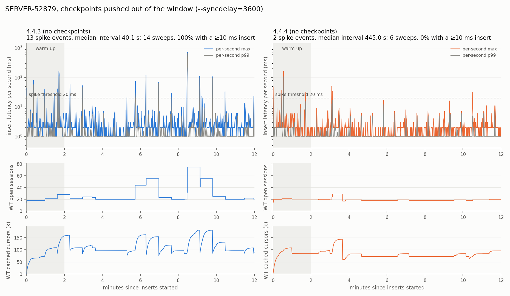

# SERVER-52879: periodic latency spikes from closing idle WiredTiger sessions under a mutex

**System:** MongoDB 3.6 – 4.4 (WiredTiger storage engine)
**Ticket:** [SERVER-52879](https://jira.mongodb.org/browse/SERVER-52879), "Periodic operation latency
spikes every 5 minutes due to closing idle cached WT sessions"
**Reproduction status:** **partially reproduced.** The mechanism, its timing and its call stack
reproduce clearly, and the fixed version does the same work without stalling. But two of the pass criteria
fixed before the runs were not met (spike regularity, and a narrow miss on the size of the improvement),
mostly because of a second, unrelated stall source (WiredTiger checkpoints) that hits both versions.
**Bug type:** latency. Periodic stalls of all operations, tens to hundreds of milliseconds long.

---

## 1. Summary

MongoDB keeps a cache of WiredTiger sessions. A background thread, the idle-session sweeper, wakes every
10 s and closes sessions that have been idle longer than `wiredTigerSessionCloseIdleTimeSecs` (default
300 s). Up to 4.4.3 it closes them **while holding the session-cache mutex**, which every operation needs to
get or return a session. With many tables, each idle session holds thousands of cached cursors and closing
them takes tens of milliseconds, so every operation stalls for that long. The fix (4.4.4) closes the sessions
after releasing the mutex.

With the ticket's workload (1,000 collections × 10 indexes, 100 inserting threads), 4.4.3 vs 4.4.4,
WiredTiger checkpoints pushed out of the measurement window:

| | 4.4.3 (bug) | 4.4.4 (fix) |
|---|---|---|
| session-close sweeps seen | 14 | 6 |
| sweeps that came with an insert stall ≥ 10 ms | **14 of 14 (100%)** | **0 of 6 (0%)** |
| worst insert latency in a sweep interval, median | **31 ms** | 2 ms (the baseline) |
| latency spikes ≥ 20 ms in 10 min | 13 (10 of them at sweeps) | 2 |
| slowest single insert | **726 ms** | 51 ms |
| inserts slower than 100 ms (slow-query log) | 70 | 0 |
| insert p99.9 | 26 ms | 5 ms |
| throughput | 946 inserts/s | 948 inserts/s |

Profiling one sweep on 4.4.3 shows the sweeper inside `closeExpiredIdleSessions → ~WiredTigerSession →
__session_close` while 57 inserting threads wait on the mutex in `WiredTigerSessionCache::getSession` for up
to 57 ms. On 4.4.4 the sweeper does the same work and no thread waits.

## 2. The bug

### What goes wrong

`src/mongo/db/storage/wiredtiger/wiredtiger_session_cache.cpp`, MongoDB 4.4.3:

```cpp
void WiredTigerSessionCache::closeExpiredIdleSessions(int64_t idleTimeMillis) {
    ...
    auto cutoffTime = _clockSource->now() - Milliseconds(idleTimeMillis);
    {
        stdx::lock_guard<Latch> lock(_cacheLock);          // held for the whole loop
        for (auto it = _sessions.begin(); it != _sessions.end();) {
            auto session = *it;
            if (session->getIdleExpireTime() < cutoffTime) {
                it = _sessions.erase(it);
                delete (session);                          // WT_SESSION::close() under the lock
            } else { ++it; }
        }
    }
}
```

- `getSession()` and `releaseSession()` both take `_cacheLock`, and every operation calls both. While the
  loop above runs, every operation that needs a session waits.
- `delete session` → `WT_SESSION::close` → WiredTiger `__session_close`, which closes every cursor cached in
  the session (`__session_close_cached_cursors`) and drops its cached data-handle references
  (`__session_discard_dhandle`).
- Why sessions hold so many cursors: when a session is returned, its cursors go into WiredTiger's
  per-session cursor cache. In this workload each insert touches 12 tables (collection, `_id` index and 10
  indexes) of ~12,000, so a session collects thousands of cached cursors. **The cost of closing a session
  grows with the number of tables.**

### Why it repeats

The ticket's reporter (Bruce Lucas) explained the feedback loop:

1. A sweep closes sessions under the mutex, and up to 100 operations (one per client thread) queue behind it.
2. When the mutex is released they all run at once and need ~100 sessions, so new sessions are opened and
   then all returned to the cache.
3. Normal traffic has low concurrency and keeps reusing only the most recent few sessions (the cache is a
   stack), so the rest go idle *together*.
4. At a later sweep they expire together, are closed together under the mutex, and the cycle restarts.

### Timing

The sweeper wakes every 10 s. Sessions that go idle just after a sweep are not yet over the timeout *T* at
the sweep *T* seconds later, so they are closed one tick after that. The spike period is therefore
(⌊*T*/10⌋ + 1) × 10 s: **40 s for *T* = 30** (the ticket's test setting) and about **310 s for the default
*T* = 300**, the "every 5 minutes" in the ticket title. We measured the same 40 s period in the ticket's own
charts.

### The fix

Commit [`d6a3d7b707df`](https://github.com/mongodb/mongo/commit/d6a3d7b707df26dfdc64b1ffd7264fae2886ec50)
(v4.4, 4.4.4; same change on master, v4.2 and v4.0) moves expired sessions to a local list under the lock and
deletes them after releasing it:

```diff
     auto cutoffTime = _clockSource->now() - Milliseconds(idleTimeMillis);
+    SessionCache sessionsToClose;
     {
         stdx::lock_guard<Latch> lock(_cacheLock);
 ...
                 it = _sessions.erase(it);
-                delete (session);
+                sessionsToClose.push_back(session);
 ...
     }
+    // Closing expired idle sessions is expensive, so do it outside of the cache mutex. This helps
+    // to avoid periodic operation latency spikes as seen in SERVER-52879.
+    for (auto session : sessionsToClose) {
+        delete session;
+    }
```

| line | affected | first fixed |
|---|---|---|
| 3.6 | 3.6.21 (listed) | not fixed |
| 4.0 | 4.0.21 (listed) | 4.0.23 |
| 4.2 | 4.2.10 (listed) | 4.2.12 |
| 4.4 | 4.4.0 – 4.4.3 | 4.4.4 |

## 3. Effects

- **Periodic stalls of every operation.** Each sweep that closes many sessions blocks all operations that
  need a session for as long as the closing takes. In our runs on 4.4.3, **every** sweep came with an insert
  stall (median worst latency 29–31 ms in the sweep interval vs a 2 ms baseline; up to 726 ms). With the
  default timeout this happens about every 5 minutes.
- **The stall size scales with the number of tables** (cursors and data handles cached per session) and
  with how many sessions expire together. Deployments with thousands of collections and indexes are the
  ones affected.
- **Throughput is not visibly affected** (~945 inserts/s in both versions here): the cost is latency
  outliers, i.e. p99.9 and max, which is what the reporter's customer noticed.
- **Visible signature:** a sawtooth in WiredTiger's "cached cursor count" and "open session count" in step
  with latency spikes (figure 1). The reporter asked for a counter of sessions closed by the sweeper; it was
  not added.



*Figure 1. 4.4.3 (left) vs 4.4.4 (right), checkpoints pushed out of the window. Top: per-second worst and
p99 insert latency (log scale). Middle: open WiredTiger sessions; the steps up are bursts of new sessions
after a stall, the steps down are sweeps closing them. Bottom: cached cursors, with a drop at every sweep.
On 4.4.3 the latency spikes line up with the sweeps; on 4.4.4 the same sweeps cause no spikes.*

## 4. Reproduction

### 4.1 Setup

- **Hardware:** Apple M1 Pro laptop, Docker Desktop Linux VM (arm64, 10 vCPU, 7.75 GiB), shared with 5
  unrelated containers whose CPU use was recorded.
- **Server:** official `mongo:4.4.3` (last release with the bug) vs `mongo:4.4.4` (first with the fix),
  standalone, 1 GB WiredTiger cache, `wiredTigerSessionCloseIdleTimeSecs=30` as in the ticket.
- **Workload:** the ticket's `repro.js`. 1,000 collections × 10 secondary indexes (~12,000 WiredTiger
  tables), then 100 threads each inserting into a random collection about 10 times per second (~1,000
  inserts/s in total), for 12 minutes. The first 2 minutes are a warm-up and are not counted.
- **Detection:** a *spike event* is a second whose worst insert latency is ≥ 20 ms. A *sweep* is a drop in
  WiredTiger's cached-cursor count between two 1 s samples.
- **Measurements:** per-insert client log, serverStatus at 1 Hz, FTDC, mongod log, Docker stats.

### 4.2 Runs

| run | version | what | why |
|---|---|---|---|
| A / B | 4.4.3 / 4.4.4 | default settings, *T* = 30 | main comparison |
| V1 | 4.4.3 / 4.4.4 | checkpoints pushed out (`--syncdelay=3600`) | removes the checkpoint stalls that hit both versions |
| C / C2 | 4.4.3 | *T* = 60, with / without checkpoints | the period should move from 40 s to 70 s |
| P | 4.4.3 / 4.4.4 | perf + gdb during the run | symptom function and call stack |

### 4.3 Results

| | A 4.4.3 | B 4.4.4 | V1 4.4.3 | V1 4.4.4 | C2 4.4.3 *T*=60 |
|---|---|---|---|---|---|
| sweeps | 14 | 11 | 14 | 6 | 11 |
| sweeps with an insert ≥ 10 ms | **100%** | **0%** | **100%** | **0%** | 100% |
| worst latency in sweep intervals, median | 29 ms | 2 ms | 31 ms | 2 ms | 48 ms |
| median time between sweeps | 40 s | 45 s | 40 s | 60 s | 70 s |
| spike events (≥ 20 ms) | 14 | 13 | 13 | 2 | 19 |
| spikes that coincide with a sweep | 11 of 14 | 2 of 13 | 10 of 13 | 0 of 2 | 10 of 19 |
| slowest insert | 365 ms | 556 ms | 726 ms | 51 ms | 304 ms |
| inserts > 100 ms | 101 | 125 | 70 | 0 | 126 |

- **Sweep-locked stalls:** on 4.4.3, 100% of sweeps carry an insert stall in every run; on 4.4.4, 0%,
  although 4.4.4 closes as many cursors per sweep (median 24k vs 16k in A/B).
- **Period follows the timeout:** 40 s between sweeps at *T* = 30 and 70 s at *T* = 60, as the formula
  predicts (`figures/SERVER-52879_period_vs_timeout.png`).
- **Checkpoint stalls hit both versions:** with default settings, WiredTiger checkpoints (every ~70 s here)
  cause 100–700 ms all-thread stalls in *both* 4.4.3 and 4.4.4, a known separate issue with many data
  handles ([WT-5479](https://jira.mongodb.org/browse/WT-5479)). That is why B (4.4.4) has as many spike
  events as A. With checkpoints pushed out (V1), 4.4.4 is nearly silent.

### 4.4 Pass criteria (fixed before the runs)

| criterion | result |
|---|---|
| S1: ≥ 8 spike events on 4.4.3 | **met** (14; 13 in V1) |
| S2: median interval 40 ± 5 s *and* ≥ 75% of intervals in [35, 45] s | **not met**: median 40.0 s, but only 38% of intervals (42% in V1), because non-sweep spikes fall in between |
| S3: 4.4.4 has ≤ 2 spike events *and* a ≥ 5× lower 99.5th percentile of per-second worst latency | **not met**: default settings 13 events; V1 2 events but 4.9× |
| S4: *T* = 60 moves the median interval to 70 ± 5 s | not met on spike events (interleaved non-sweep spikes); met on sweeps (70 s) |
| S5: profile shows the predicted stacks | **met** (section 5) |

**Verdict: partially reproduced.** The mechanism is reproduced cleanly, but the stalls are smaller and less
regular than in the ticket. Our reading: on this 10-vCPU VM the self-sustaining cycle of section 2 only
sometimes builds up (open sessions jump to 40–75 after some stalls and stay near 20 after others, figure 1),
and checkpoint and other stalls add spikes in both versions.

## 5. Symptom function and call stack

**Symptom function: `mongo::WiredTigerSessionCache::closeExpiredIdleSessions`** (in the sweeper thread),
which makes every operation wait in **`mongo::WiredTigerSessionCache::getSession`**.

Method: `perf record -e cpu-clock -F 999 --call-graph fp` on all mongod threads for 100 s, plus the
scheduler events `sched_switch` / `sched_waking` for off-CPU (waiting) time, plus a gdb snapshot of all
threads taken with mongod frozen by SIGSTOP the moment the sweeper became busy.

**Sweeper thread** (gdb snapshot, 4.4.3):

```
#0  tc_free
#1  __wt_cursor_close
#2  __curfile_close
#3  __session_close_cursors
#4  __session_close_cached_cursors
#5  __wt_session_close_internal
#6  __session_close
#7  mongo::WiredTigerSession::~WiredTigerSession
#8  mongo::WiredTigerSessionCache::closeExpiredIdleSessions     <- holds _cacheLock (4.4.3)
#9  mongo::WiredTigerKVEngine::WiredTigerSessionSweeper::run
#10 mongo::BackgroundJob::jobBody
```

On-CPU samples of the sweeper during the sweep (57 samples, one 57 ms sweep):

| function (inclusive) | 4.4.3 | ticket (perf) |
|---|---|---|
| `closeExpiredIdleSessions` → `~WiredTigerSession` → `__session_close` | 100% | – |
| `__session_close_cached_cursors` (closing cached cursors) | 91% | ~65% |
| `__wt_session_close_cache` → `__session_discard_dhandle` (dropping data handles) | 9% | ~25% |

Hottest leaves: `__wt_cursor_reopen` 37%, `__wt_readlock` 18%, freeing memory 14%.
Flame graph: `figures/SERVER-52879_oncpu_sweeper_4.4.3.svg`.

**Waiting threads** (off-CPU, same sweep): **57 connection threads** blocked on the session-cache mutex,
1,891 ms of waiting in total, the longest 57 ms, equal to the slowest client insert. Stack (leaf first):

```
__pthread_mutex_lock
mongo::latch_detail::Mutex::lock
mongo::WiredTigerSessionCache::getSession
mongo::WiredTigerRecoveryUnit::_ensureSession
mongo::WiredTigerRecoveryUnit::_txnOpen
mongo::WiredTigerRecoveryUnit::getSession
mongo::WiredTigerCursor::WiredTigerCursor
mongo::WiredTigerRecordStore::_insertRecords
mongo::WiredTigerRecordStore::insertRecords
mongo::CollectionImpl::_insertDocument
```

About 99.6% of all session-cache waiting in the 100 s recording fell inside the sweep.

**Control (4.4.4):** the sweeper has the same stacks and the same split (90% / 10%) during a 44 ms sweep,
but **0 threads** wait during it, and only 2.2 ms of session-cache waiting occurs in the whole recording.

## 6. Reproduction pipeline

Everything runs in Docker; nothing else is needed on the host (arm64 or x86-64). Folder:
`perf-bug-repros/SERVER-52879/`.

### 6.1 Bug and fix runs

```bash
cd SERVER-52879
./run.sh 4.4.3 --mongod-arg --syncdelay=3600     # bug: ~13 min (30 s setup, 12 min inserts, analysis)
./run.sh 4.4.4 --mongod-arg --syncdelay=3600     # fix: identical workload
./analyze.sh results/runs/<4.4.3-label> results/runs/<4.4.4-label> --compare-out results --names "4.4.3,4.4.4"
```

`--syncdelay=3600` keeps checkpoints out of the 12-minute window so that only this bug's stalls remain.
Leave it out to see the default behaviour, including the checkpoint stalls in both versions.

What `run.sh` does, in order:

1. Starts mongod in a container (1 GB cache, fresh volume), sets `wiredTigerSessionCloseIdleTimeSecs`
   (default 30 here, `--idle-timeout` to change).
2. Creates 1,000 collections × 10 indexes (~30 s).
3. Starts a sampler: serverStatus at 1 Hz, Docker stats.
4. Runs the 100-thread insert workload (legacy `mongo` shell) for 12 minutes, logging every insert.
5. Collects the mongod log and FTDC, removes the containers and the volume.
6. Writes `results/runs/<label>/`: `summary.md` (spikes, sweeps, intervals, percentiles), `timeline.png`,
   `per_second.csv`, `raw/`.

**Causal check:** `./run.sh 4.4.3 --idle-timeout 60 --mongod-arg --syncdelay=3600` → sweeps and stalls
~70 s apart instead of ~40 s.

### 6.2 Detecting the bug automatically

- **Client:** `raw/client.log` has one line per insert, `O,<thread>,<start_epoch_ms>,<latency_ms>`.
- **Server:** a sweep shows as a drop of 15–36k in WiredTiger's "cached cursor count" (and in "open session
  count") between two 1 s samples. On 4.4.3 the per-second worst insert latency jumps to tens of ms in the
  same second; on 4.4.4 it stays at ~2 ms.
- `summary.md` lists every spike and every sweep with its time and whether they coincide.

### 6.3 Running it against your own (instrumented) mongod

```bash
# an already-running mongod (the idle timeout is set at runtime)
./run.sh --target 10.0.0.5:27017 --idle-timeout 30 --label my-run
# your own image, started like the official one
./run.sh --image registry.example.com/mongod-instrumented:4.4.3 --label instr-4.4.3
# your own mongod binary inside the official 4.4.3 image (Ubuntu 20.04 userland)
./run.sh 4.4.3 --mongod-binary /path/to/mongod --label instr-bin
```

`--skip-setup` reuses an existing 1,000 × 10 dataset; `--no-set-idle` leaves the server parameter alone.
For a single-commit comparison, build r4.4.3 and r4.4.3 + `d6a3d7b` (the two releases differ by 64 commits).

### 6.4 Profiling

```bash
./run.sh 4.4.3 --duration 600 --profile --profile-delay 150 \
    --profile-args "--secs 100 --snapshot --snapshot-timeout 200"
./profile.sh --host-pid $(pgrep -o mongod) --secs 100 --snapshot --event cycles   # native mongod on Linux
```

Output in `results/runs/<label>/profile/`: `profile_summary.md`, `oncpu_sweeper.svg`, `offcpu_sweeps.svg`,
`snapshot_summary.md`.

### 6.5 Pitfalls

- Checkpoints cause their own stalls in both versions; use `--syncdelay=3600` when you want only this bug.
- The default timeout (300 s) gives one spike every ~5 minutes; use `--idle-timeout 30` for short runs.
- The effect needs many tables; fewer collections give smaller stalls.
- perf in a container needs `--privileged` and mongod's PID namespace (`profile.sh` handles both).

## 7. Developer discussion

Full Jira export (description, all comments), attachments, fix diffs and source copies are in
`SERVER-52879/discussion/`; `DISCUSSION.md` there has the details.

- **Reporter:** Bruce Lucas (MongoDB), 2020-11-16, from a customer issue. Test: 1,000 collections ×
  10 indexes, ~1,000 inserts/s from 100 threads, `wiredTigerSessionCloseIdleTimeSecs=30`. FTDC showed
  periodic spikes up to 29 ms in *average* write latency, with open sessions and cached cursors oscillating
  in step. perf: `closeExpiredIdleSessions` spends ~65% of its time closing cached cursors and ~25% in
  `__session_discard_dhandle`, both proportional to the number of tables.
- **His diagnosis:** the mutex is held while closing; the released burst opens ~100 sessions that later
  expire together (section 2). Suggested fix: find idle sessions under the mutex, close them outside it.
  He also asked for a metric of sessions closed from the cache (not added).
- **Fix:** Gregory Wlodarek, committed 2021-01-07 (master `d517928d5b34`), backported 2021-01-08 to v4.4
  `d6a3d7b707df` (4.4.4), v4.2 `455bdbb8bcc2` (4.2.12) and v4.0 `b01d1f1c14f1` (4.0.23). His before/after
  charts on the same workload: worst per-second average write latency 8.06 ms → 0.27 ms, open sessions
  48 → 18.
- Bruce retitled the ticket to "every 5 minutes" so the production symptom (default timeout) is easy to find.

## 8. Limitations

- **Partial by the pre-registered rule:** S2 (regularity) and S3 (size of the improvement) were not met;
  S3 missed narrowly with checkpoints removed (4.9× vs 5×).
- **Laptop Docker VM on arm64**, shared with other containers. All runs were made while the laptop was on
  battery with macOS Low Power Mode (slower CPU). Both versions ran under the same conditions, so the
  comparison is fair, but absolute numbers may differ on AC power or a server.
- 4.4.3 vs 4.4.4 are release builds 64 commits apart, not a single-commit comparison; the profile (same
  sweeper work, waiters only on 4.4.3) is the evidence that the difference is this fix.
- Only one heavy sweep was captured by the profiler (57 samples).
- A cleaner rerun would use a many-core x86-64 Linux server with source builds of r4.4.3 and
  r4.4.3 + `d6a3d7b`.

## 9. Where everything is

| what | path |
|---|---|
| scripts | `SERVER-52879/run.sh`, `profile.sh`, `analyze.sh`, `profiling/`, `analysis/` |
| workload (original and adapted) | `SERVER-52879/workload/` |
| plan, pass criteria, change log, outcome | `SERVER-52879/PLAN.md` |
| results | `SERVER-52879/results/summary.md`, `results/v1/`, `results/runs/<label>/` |
| profiles | `SERVER-52879/results/runs/P-4.4.3-profile/profile/`, `P-4.4.4-profile/profile/` |
| developer discussion | `SERVER-52879/discussion/DISCUSSION.md` and the Jira JSON next to it |
