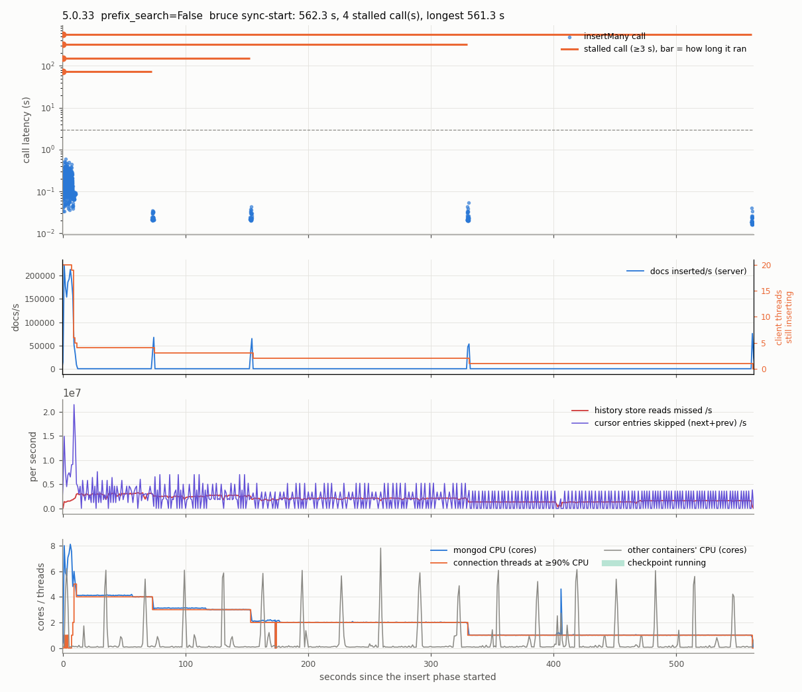
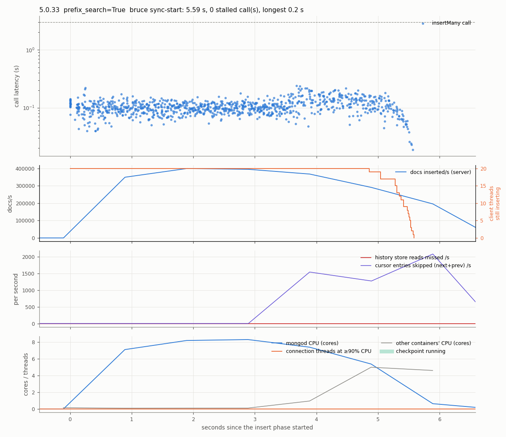
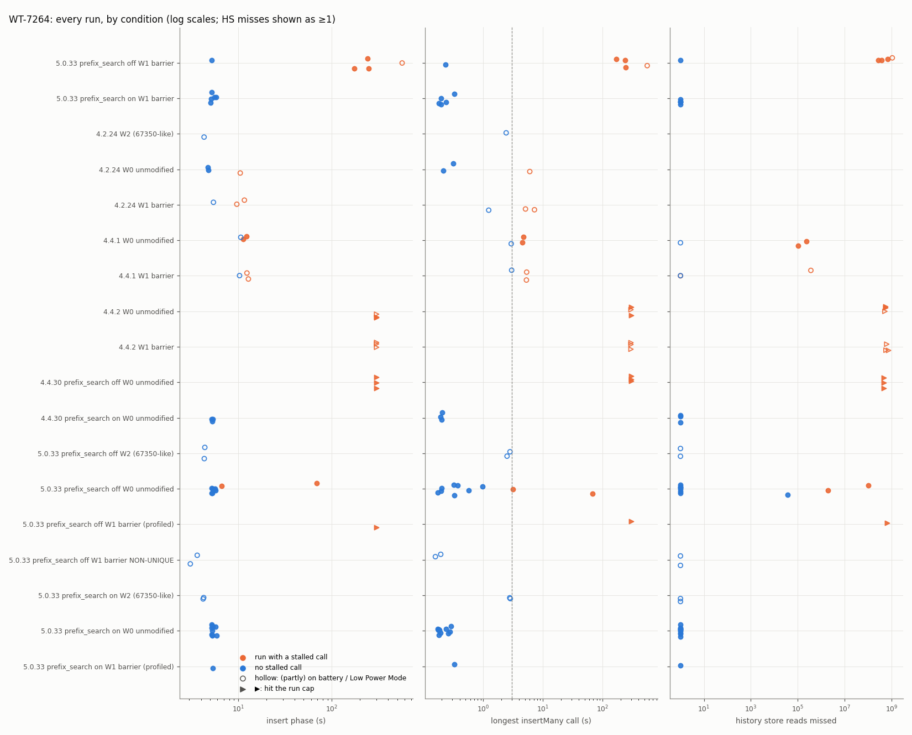

# WT-7264 / SERVER-67350: unique-index inserts stuck in `search_near`

**System:** MongoDB 4.4 and 5.0 (WiredTiger storage engine)
**Tickets:** [WT-7264](https://jira.mongodb.org/browse/WT-7264) (root cause and WiredTiger fix),
[SERVER-67350](https://jira.mongodb.org/browse/SERVER-67350) (the same bug reported by a user),
[SERVER-61185](https://jira.mongodb.org/browse/SERVER-61185) (the server-side fix that shipped)
**Reproduction status:** **reproduced.** All five pass criteria, fixed before the main runs, are met, on a
single binary where the fix can be switched on and off at runtime.
**Bug type:** latency and CPU. Single insert calls stall for minutes while burning one core each.

---

## 1. Summary

In MongoDB 4.4 and 5.0, every insert into a **unique index** first checks whether the key already exists by
calling WiredTiger's `search_near`. If the key `search_near` lands on is not visible to the inserting
transaction, `search_near` keeps stepping to the next (and then previous) key until it finds a visible one.
When many concurrent inserters have just written keys next to each other, one transaction can have
thousands to millions of invisible keys around its insert point. Once those keys' pages have been evicted
from cache, every step also costs a history-store lookup that finds nothing. The insert then spins at 100%
CPU for seconds to many minutes, and nothing is logged.

On one MongoDB 5.0.33 binary, with Bruce Lucas's workload from the ticket (20 threads inserting into a
collection with two unique indexes):

| | fix off (bug) | fix on |
|---|---|---|
| runs with a stalled insert | **4 of 5** | **0 of 5** |
| how long the stuck inserts ran | 73 s to **561 s** | longest insert 0.33 s |
| time to insert 2 M documents | 173–562 s (one run: 5.2 s) | 5.0–5.8 s |
| "history store table reads missed" | 2.7–10.8 × 10⁸ per stalled run | 0 |

The stuck thread's CPU profile matches the call graph attached to the ticket: 67.7% / 32.3% here vs
66.8% / 33.2% in the ticket (section 5).

## 2. The bug

### What goes wrong

A secondary unique index stores `(key, RecordId)` entries, so the key alone is a *prefix*. To insert a
document with `a: 5`, `WiredTigerIndexUnique::_insert` does four things inside the inserting transaction:

1. insert the bare prefix `5`;
2. remove it again (this makes concurrent inserters of the same value conflict);
3. call `_keyExists`, which does `search_near(5)` and checks whether the key it lands on starts with `5`;
4. insert `(5, RecordId)`.

Step 3 is the problem. `search_near(k)` must return `k` or the nearest *visible* key. Since
[WT-5461](https://jira.mongodb.org/browse/WT-5461) (4.4.0), cursor `next`/`prev` skip any key whose
transaction read finds nothing visible, instead of returning the on-page value. So if the keys around
`5` are invisible to this transaction, `search_near` walks over all of them, first `next` to the end of the
table and then `prev`.

Two conditions make the walk expensive:

- **Invisible neighbours.** In Bruce's workload each of 20 threads appends ascending keys in its own key
  range. A thread whose first transaction took its snapshot before its neighbours committed cannot see any
  key they insert while that transaction is open. Every one of those keys is on its walk, and the slower
  the walk, the longer the transaction stays open and the more invisible keys pile up.
- **Durable history (4.4+).** WiredTiger 4.4 can evict a page as long as it has some committed updates, and
  writes the newest committed version to disk. A reader whose snapshot is older than that version must look
  in the history store (`__wt_hs_find_upd`) for an older one. For a freshly inserted key there is none, so
  every lookup misses ("history store table reads missed"). In 4.2 such pages stayed in memory and the same
  walk was cheap.

### The fix

WT-7264 added a `prefix_search=true` option to WiredTiger's `search_near`. With it, the walk stops as soon
as the keys no longer start with the searched prefix, which is all a duplicate-key check needs. The server
started using it with [SERVER-61185](https://jira.mongodb.org/browse/SERVER-61185), behind the server
parameter `wiredTigerPrefixSearchForUniqueIndexes`:

| version | slow path by default? |
|---|---|
| 4.2.x | no (no durable history) |
| 4.4.0 – 4.4.17 | **yes** (no fix available) |
| 4.4.18 – 4.4.30 | **yes**: the fix exists but the parameter defaults to *false* ([SERVER-85371](https://jira.mongodb.org/browse/SERVER-85371) to change that was "Won't Do") |
| 5.0.0 – 5.0.13 | **yes** |
| 5.0.14+ | no (parameter defaults to *true*) |
| 5.3.0+ | no |

The parameter can be changed at runtime, so **one binary can run both the buggy and the fixed path**. That
is the main comparison here. Versions 4.4.7, 5.0.0 and 5.0.1 contain an earlier fix attempt
(SERVER-56509) that broke unique-index enforcement (SERVER-58936) and must not be used.

## 3. Effects

- **Stuck inserts.** An `insertMany` call can take minutes instead of a fraction of a second. In our runs
  the stuck call was always a thread's *first* call. The other 1,000 calls of a run take about 0.1 s each
  and finish within ~10 s, after which the database sits at 0 inserts/s while the stuck calls run
  (figure 1).
- **One core per stuck thread at 100% CPU.** While only the stuck calls were left, the number of connection
  threads at ≥ 90% CPU equalled the number of stuck threads in 3 of the 4 stalled main runs (3/3, 1/1, 1/1;
  the fourth had 2 of 4). On 4.4.30, 12–15 stuck threads shared the 10 cores. The reporter of
  SERVER-67350 saw the same: "one or two cores at 100% CPU".
- **Invisible to normal monitoring.** Nothing appears in the log, `currentOp`, `mongotop` or `mongostat`
  until the call returns (SERVER-67350). The signature is in serverStatus/FTDC: about 10⁶ "history store
  table reads missed" per second per stuck thread, and a similar rate of "cursor entries skipped".
- **How bad it gets in the field.** The ticket started from a py-tpcc load where inserts were stuck "for
  more than a few hours". The SERVER-67350 reporter's test took 1.7 s on 4.2 and 9 min 19 s on 5.0, and up to
  40 min on slower machines. Their own logs show first commands taking up to 548 s on 4.4.14.
- **Version dependence.** On 4.4.30 with its default settings, Bruce's unchanged script got stuck in 3 of 3
  runs, with 12–15 of the 20 threads stuck at the 5-minute cap. 4.4.2 behaves the same. 4.4.1 only shows
  brief 4–5 s first calls (section 4.3).



*Figure 1. A bug-arm run (5.0.33, fix off). Top: every insertMany call; the four bars are calls that got
stuck, starting at second 0 and running up to 561 s. Second panel: documents inserted per second drop to
zero after ~10 s while 4, then 3, 2, 1 threads are still running. Third: history-store reads missed and
cursor entries skipped per second during the whole stall. Bottom: mongod CPU equals the number of stuck
threads.*



*Figure 2. The paired fix-arm run (same binary, fix on): all calls finish in ~5 s.*

## 4. Reproduction

### 4.1 Setup

- **Hardware:** Apple M1 Pro laptop, Docker Desktop Linux VM (arm64, 10 vCPU, 7.75 GiB), shared with
  5 unrelated containers whose CPU use was recorded as noise.
- **Server:** official `mongo:5.0.33` image, standalone, `--wiredTigerCacheSizeGB 1`, container limited
  to 3 GB, fresh data volume per run. Other versions: `mongo:4.4.30`, `4.4.2`, `4.4.1`, `4.2.24`.
- **Workload:** Bruce Lucas's `repro.sh` from WT-7264. 20 threads each insert 100,000 small documents
  `{_id, a, b}` with `insertMany` batches of 2,000, into a collection with **unique indexes on `a` and
  `b`**; thread *t* uses keys `t·100000 + i`.
  - **W0:** unchanged (threads start one after another, as in the original).
  - **W1 ("barrier"):** identical, except all threads start their first insert at the same moment. This
    makes the stall far more frequent on 5.0.33 (W0 stalled in only 2 of 10 runs there).
- **Stalled call:** an insertMany call that takes ≥ 3 s or is still running at the cap (600 s for the main
  comparison, 300 s elsewhere). Healthy calls take ≤ 0.6 s.
- **Measurements:** per-call client log; serverStatus at 1 Hz; per-thread CPU of every mongod thread at
  1 Hz; FTDC; mongod log; Docker stats of every container; power source of the laptop for every run.

### 4.2 Main comparison and pass criteria

Fix off vs on on the same `mongo:5.0.33` binary, W1, 5 runs each, alternating. The criteria were written
down before these runs (`WT-7264/PLAN.md`, together with 11 disclosed pilot runs):

| criterion | result | |
|---|---|---|
| S1: ≥ 3 of 5 bug-arm runs stall | 4/5 | met |
| S2: 0 of 5 fix-arm runs stall | 0/5 | met |
| S3: one-sided Fisher exact test, p < 0.05 | p = 0.024 | met |
| S4: every stalled run ≥ 10⁶ history-store misses; fix arm < 1% of that; ≥ 80% of misses accrue during the stall | 2.7–10.8 × 10⁸; fix 0; 99–100% | met |
| S5: stuck threads ≥ 50% of samples in `_keyExists` and in `__wt_hs_find_upd`; fix arm < 1% in `__wt_hs_find_upd` | 99.9% and 81.9%; fix 0.0% | met |

Every stuck call was the thread's first `insertMany`, started within 10 ms of the barrier.

### 4.3 Other conditions

| condition | runs | stalled | what happened |
|---|---|---|---|
| 5.0.33, unchanged workload W0, fix off / on | 10 / 10 | **2** / 0 | stalls of 68 s and 3.1 s; up to 1.0 × 10⁸ misses |
| 4.4.30 (default = fix off) / fix on, W0 | 3 / 3 | **3** / 0 | all 3 hit the 300 s cap, 12–15 threads stuck, ~4.7 × 10⁸ misses |
| 4.4.2, W0 and W1 | 3 + 3 | **3 + 3** | all hit the 300 s cap, 2.8–7.5 × 10⁸ misses |
| 4.4.1, W0 and W1 | 3 + 3 | 2 + 2 | short: first calls of 4–5 s, ≤ 3.6 × 10⁵ misses (walk stays in memory) |
| 4.2.24, W0 and W1 | 3 + 3 | 0 on AC power | no history store; see the battery caveat below |
| 5.0.33, fix off, W1, **non-unique** indexes | 2 | **0** | no duplicate-key check, no stall: confirms where the bug lives |
| SERVER-67350-style workload (5 Python threads, 1 unique index) on 5.0.33 off/on and 4.2.24 | 2 / 2 / 1 | 0 | did not reproduce: the Python client's threads did not start their first command together (65–293 ms apart vs ~36 ms for the reporter's Java program) |

The 4.4.1 vs 4.4.2 difference matches the SERVER-67350 bisection, which found the regression in mongo
commit `30e753ec`, a WiredTiger import between 4.4.1 and 4.4.2 that includes WT-6490 and WT-6624 (eviction
using transaction snapshots).



*Figure 3. Every counted run as a dot, by condition (hollow markers: runs on battery).*

### 4.4 Power-source check

The laptop was on battery (with macOS Low Power Mode, which slows the CPU) for 20 of the 63 counted runs.
Every check was recomputed on the 43 runs that were entirely on AC power. All pass criteria hold
(S1 3/4 vs 0/5, p = 0.048). The only check that changes is the 4.2.24 baseline: on battery, 4.2.24 had
3–7 s stalls on *all* threads at once, with 1.5–2.6 × 10⁵ pages evicted by application threads (cache
eviction falling behind on a slowed CPU). That is a different stall, not this bug. On AC power, 4.2.24
never stalled.

## 5. Symptom function and call stack

**Symptom function: `mongo::WiredTigerIndexUnique::_keyExists`**, inside WiredTiger's
`__wt_btcur_search_near` walk, with **`__wt_hs_find_upd`** as the hot leaf.

Method: `perf record -e cpu-clock -F 999 --call-graph fp` on every mongod thread for 40 s in a privileged
sidecar container, plus off-CPU scheduler events, plus a gdb snapshot of all threads taken while mongod was
frozen with SIGSTOP the moment a connection thread had been ~100% busy for 2 s with the others idle. The
stuck threads were picked by timing only (the client log identifies which calls are stuck).

gdb snapshot of a stuck connection thread (`results/runs/P1-5.0.33-W1-off-profile/profile/snapshot_summary.md`):

```
#0  __wt_struct_packv
#1  __wt_cursor_set_keyv
#2  __wt_cursor_set_key
#3  __curhs_set_key                     build the history-store lookup key
#4  __wt_hs_find_upd                    look for an older version in the history store: nothing
#5  __wt_txn_read                       the on-disk version is newer than this snapshot
#6  __wt_btcur_prev                     search_near walks past invisible keys (next, then prev)
#7  __wt_btcur_search_near
#8  __curfile_search_near
#9  mongo::wiredTigerPrepareConflictRetry<WiredTigerIndexUnique::_keyExists(...)::{lambda()#1}>
#10 mongo::WiredTigerIndexUnique::_keyExists
#11 mongo::WiredTigerIndexUnique::_insert
#12 mongo::WiredTigerIndex::insert
#13 mongo::AbstractIndexAccessMethod::insertKeys
#14 mongo::AbstractIndexAccessMethod::insertKeysAndUpdateMultikeyPaths
#15 mongo::IndexCatalogImpl::_indexKeys
#16 mongo::IndexCatalogImpl::_indexFilteredRecords
#17 mongo::IndexCatalogImpl::_indexRecords
#18 mongo::IndexCatalogImpl::indexRecords
#19 mongo::CollectionImpl::_insertDocuments
#20 mongo::CollectionImpl::insertDocuments
#21 mongo::write_ops_exec::(anonymous namespace)::insertDocuments
#22 mongo::write_ops_exec::performInserts
#23 mongo::(anonymous namespace)::CmdInsert::Invocation::typedRun
```

On-CPU profile of the 2 stuck threads during their stalled calls (59,978 samples):

| function (inclusive) | share of stuck-thread samples |
|---|---|
| `WiredTigerIndexUnique::_keyExists` | 99.9% |
| `__wt_txn_read` | 89% |
| `__wt_hs_find_upd` | 82% |

Call tree under `_keyExists`, next to the ticket's call graph (`figures/WT-7264_ticket_callgraph_hs.png`,
29,272 samples, WiredTiger 4.4 era):

| frame | this reproduction | ticket |
|---|---|---|
| `__curfile_search_near` → `__wt_btcur_search_near` | 67.7% | 66.8% |
| └ `__wt_btcur_next[_prefix]` → `__wt_txn_read` → `__wt_hs_find_upd` | 34.6 → 31.1 → 28.3% | 32.7 → 32.7 → 32.7% |
| └ `__wt_btcur_prev` → `__wt_txn_read` → `__wt_hs_find_upd` | 33.1 → 29.2 → 27.0% | 34.1 → 34.0 → 34.0% |
| `__curfile_next` (the follow-up `next` in `_keyExists`) → `__wt_txn_read` → `__wt_hs_find_upd` | 32.3 → 29.2 → 26.6% | 33.2 → 33.2 → 33.2% |

- Inside `__wt_hs_find_upd`, each lookup opens a history-store cursor (33%), positions it (32%), builds
  its key (19%) and closes it (15%), then finds nothing.
- The stuck threads are on CPU almost all the time: at most 2 s off CPU out of 64 thread-seconds.
- In 5.0.33, `__wt_btcur_next` is a thin wrapper over `__wt_btcur_next_prefix` (added by WT-7264), which is
  why the latter appears instead.
- Fix-arm profile: `__wt_hs_find_upd` is 0.0% of connection-thread samples; `_keyExists` is 4%.
- Flame graph of the stuck threads: `figures/WT-7264_oncpu_stuck_threads.svg`.

**Relevant WiredTiger code (per the tickets):** the `search_near` loops that call `next` and `prev` in
`src/btree/bt_cursor.c`, and the "skip invisible entry" paths in `bt_curnext.c` / `bt_curprev.c`
(`if (cbt->upd_value->type == WT_UPDATE_INVALID) { ++*skippedp; continue; }`), which is the code WT-5461
introduced and WT-7264's `prefix_search` early exit short-circuits.

## 6. Reproduction pipeline

Everything runs in Docker; nothing else is needed on the host (arm64 or x86-64). Folder:
`perf-bug-repros/WT-7264/`.

### 6.1 One bug run and one fix run

```bash
cd WT-7264
./run.sh 5.0.33 --sync-start --prefix-search off     # bug: ~3–10 min when it stalls, cap 600 s
./run.sh 5.0.33 --sync-start --prefix-search on      # fix: ~1 min including setup
```

What `run.sh` does, in order:

1. Pulls the image if needed and starts mongod in a container (cache 1 GB, memory 3 GB, fresh volume),
   with `wiredTigerPrefixSearchForUniqueIndexes` set as requested; checks it with `getParameter`.
2. Starts a sampler in mongod's PID namespace: serverStatus and per-thread CPU at 1 Hz, plus Docker stats.
3. Creates the collection and the two unique indexes.
4. Runs the 20-thread workload in a client container (the legacy `mongo` shell from 5.0.33), logging every
   call; kills it at the cap.
5. Collects the mongod log and FTDC, stops and removes the containers and the volume.
6. Writes `results/runs/<label>/`: `summary.md` / `summary.json`, `timeline.png`, `calls.csv`, `raw/`.

### 6.2 The other comparisons

```bash
./run.sh 4.4.30                                 # 4.4 with its default (fix off): stalls every time here
./run.sh 4.4.30 --prefix-search on              # same binary, fix on
./run.sh 5.0.33 --prefix-search off             # unchanged workload W0: stalls ~1 run in 5 here
./run.sh 4.4.2 ; ./run.sh 4.4.1 ; ./run.sh 4.2.24
./campaign.sh A U                               # the exact main campaign (5+5 and 10+10 runs)
./analyze.sh results/runs/[A-Z]* --compare-out results --reuse   # cross-run summary.md and plots
```

**Recommended trigger for automated, repeated runs:** 4.4.30 with the fix off vs on and the unchanged
workload (3/3 vs 0/3 here), with a shorter cap such as `--cap 120`. It stalls every time and needs only one
binary. It keeps 12–15 threads stuck, so it is CPU-heavy. The barrier workload on 5.0.33 is the
alternative (4/5).

### 6.3 Detecting the bug automatically

- **Client:** `raw/client.log` has `S,<thread>,<batch>,<start_ms>` when a call starts and
  `B,<thread>,<batch>,<start_ms>,<latency_ms>` when it returns. A stuck call has an `S` line with no `B` line
  for ≥ 3 s. `summary.json` has `stalled`, `stalled_calls`, `longest_call_s`.
- **Server:** `wiredTiger.cache["history store table reads missed"]` rising at ~10⁶/s per stuck thread,
  and `wiredTiger.cursor["Total number of entries skipped by cursor next calls"]` (and `prev`) at a similar
  rate, while inserts/s are ~0. With the fix on, `"Total number of times a search near has exited due to
  prefix config"` counts ~3.2–3.8 M per run instead.

### 6.4 Running it against your own (instrumented) mongod

```bash
# an already-running mongod; the parameter is set at runtime (4.4.18+ / 5.0.14+ only)
./run.sh --target 10.0.0.5:27017 --sync-start --prefix-search off --label my-run
# your own image, started like the official one
./run.sh --image registry.example.com/mongod-instrumented:5.0.33 --sync-start --prefix-search off
# your own mongod binary inside the official 5.0.33 image (Ubuntu 20.04 userland)
./run.sh 5.0.33 --mongod-binary /path/to/mongod --sync-start --prefix-search off
```

Give it an empty database (the workload writes to `test.c`). Older builds without the parameter always take
the slow path.

### 6.5 Profiling

```bash
./run.sh 5.0.33 --sync-start --prefix-search off --profile --profile-args "--secs 40 --snapshot"
./profile.sh --host-pid $(pgrep -o mongod) --secs 40 --snapshot --event cycles   # native mongod on Linux
```

Output in `results/runs/<label>/profile/`: `profile_summary.md`, `oncpu_stuck.svg`, `snapshot_summary.md`.

### 6.6 Pitfalls

- The bug is intermittent with the unchanged workload on 5.0.33; use the barrier workload or 4.4.30.
- Don't use 4.4.7, 5.0.0 or 5.0.1 (unique constraints not enforced, SERVER-58936).
- Keep the machine awake and on AC power: a laptop that sleeps freezes the Docker VM mid-run, and battery
  power slows the CPU enough to cause unrelated eviction stalls.
- A stalled run is CPU-bound for the whole cap; budget the time (the main 5+5 campaign took ~25 min).

## 7. Developer discussion

Full Jira exports (every comment), attachments, fix diffs and source snapshots are in
`WT-7264/discussion/`; `DISCUSSION.md` there has the complete timeline.

| ticket | role | resolution |
|---|---|---|
| [WT-5461](https://jira.mongodb.org/browse/WT-5461) | introduced the behaviour (cursor next/prev skip invisible values) | 4.4.0-rc0 |
| [WT-7264](https://jira.mongodb.org/browse/WT-7264) | diagnosis; `prefix_search` option for `search_near` | fixed, WT 10.0.1 / 4.4.7 / 5.0.0 |
| [SERVER-56509](https://jira.mongodb.org/browse/SERVER-56509) | first server fix | reverted (broke uniqueness, SERVER-58936) |
| [SERVER-61185](https://jira.mongodb.org/browse/SERVER-61185) | shipped server fix | 5.3.0; 5.0.14 (on); 4.4.18 (off by default) |
| [SERVER-67350](https://jira.mongodb.org/browse/SERVER-67350) | user report: 1.7 s on 4.2 vs 9 min 19 s on 5.0 | duplicate of WT-7264 |
| [SERVER-85371](https://jira.mongodb.org/browse/SERVER-85371) | turn the fix on by default in 4.4 | Won't Do |

Key points from the discussion:

- **Origin (Sulabh Mahajan, 2021-03):** a py-tpcc load phase where a few inserts were stuck "for more than a
  few hours", repeatedly searching the history store with a very high "reads missed" count.
- **Repro (Bruce Lucas):** the 20-thread script used here. 4.2: steady rate, all threads finish together.
  4.4: "a couple of the threads typically seem to get stuck apparently indefinitely". The problem exists in
  4.4.0, and its behaviour changed between 4.4.1 and 4.4.2.
- **Diagnosis (Luke Pearson, 2021-03/04):** the searching thread "is calling next and prev a LOT because
  nothing is visible to it"; each step on an evicted page becomes a history-store lookup that finds nothing.
  Root cause: "a change introduced by WT-5461", which stopped returning the on-page value when nothing was
  visible. 4.2 was fast because such pages could not be evicted. With the `prefix_search` patch, the full repro
  took 8.7 s vs 7.9 s on 4.2.
- **SERVER-67350 (2022):** the user's Java program with 5 connections stalled on 4.4 and 5.0 but not 4.2;
  MongoDB bisected it to WiredTiger import `30e753ec` (between 4.4.1 and 4.4.2) and closed it as a
  duplicate: "we're not being very efficient when checking for the existence of duplicate keys when
  inserting documents, something that changed in 4.4."
- **Fix commits:** WiredTiger `652def8a` (WT-7264); server SERVER-61185 master `f18bb1e1` + `5923aa87`,
  v5.0 `61c97688`, v4.4 `17f21f74`.

## 8. Limitations

- Laptop Docker VM on arm64, shared with other containers; not a dedicated x86-64 server.
- The main comparison uses the barrier variant of the workload; the unchanged workload stalls in only
  ~20% of runs on 5.0.33 here (but every time on 4.4.30 and 4.4.2).
- 20 of the 63 counted runs were partly or fully on battery power. This is disclosed per run, and every
  check is also reported on AC-only runs.
- 5 runs were excluded (the laptop slept mid-run, or the run was aborted by a pause); their data is kept.
- 4.4.1 vs 4.4.2 compares release builds, not a single commit. Sample sizes are small (2–10 per condition).
- The SERVER-67350 reporter's own workload did not reproduce with our Python driver variant.

## 9. Where everything is

| what | path |
|---|---|
| scripts (entry point, campaign, profiling, analysis) | `WT-7264/run.sh`, `campaign.sh`, `profile.sh`, `analyze.sh`, `profiling/`, `analysis/` |
| workload (original and adapted) | `WT-7264/workload/` |
| plan, pass criteria, change log | `WT-7264/PLAN.md` |
| all results, per condition and per run | `WT-7264/results/summary.md`, `results/run_index.md`, `results/runs/<label>/` |
| profiles | `WT-7264/results/runs/P1-5.0.33-W1-off-profile/profile/`, `P1-5.0.33-W1-on-profile/profile/` |
| developer discussion | `WT-7264/discussion/DISCUSSION.md` and the Jira JSON exports next to it |
